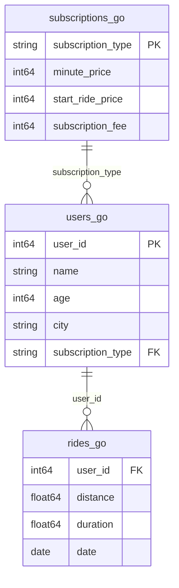

# Анализ пользовательской базы, тарифов и выручки сервиса аренды самокатов GoFast

Аналитический проект для сервиса проката электросамокатов GoFast: исследование аудитории и параметров поездок, сравнение экономики бесплатного и подписочного тарифов, статистическая проверка продуктовых гипотез и моделирование промо-акций.

**Автор:** Затула Денис Викторович  
**Стек:** Python (pandas, NumPy, Matplotlib, SciPy)  

---

## Бизнес-задачи

1. **Аудит данных и профилирование аудитории:** очистить данные о пользователях и поездках, оценить географию сервиса, долю подписчиков `ultra`, возрастной профиль и базовые параметры поездок (дистанция и длительность).
2. **Расчет помесячной выручки:** объединить данные пользователей, поездок и тарифной сетки, рассчитать помесячную выручку на одного пользователя по формуле тарифа (с округлением длительности каждой поездки вверх до целых минут).
3. **Проверка продуктовых гипотез:**
   - тратят ли подписчики `ultra` больше времени на поездки, чем пользователи тарифа `free`;
   - превышает ли средняя дистанция поездки подписчиков `ultra` оптимальный с точки зрения износа порог 3 130 м;
   - превышает ли помесячная выручка от подписчиков `ultra` выручку от пользователей без подписки.
4. **Вероятностное моделирование промо-механик:** оценить долю поездок подписчиков длительностью более 30 минут и от 20 до 30 минут для планирования маркетинговых акций, а также рассчитать критическую дистанцию (90-й процентиль) для политики доплат.

---

## Структура проекта

```text
RidesGoAnalysis/
├── .gitignore                         # Исключения Git для Python, Jupyter, IDE и ОС
├── README.md                          # Описание проекта, модель данных и выводы
├── notebooks/
│   └── rides_go_analysis.ipynb        # Исследовательский анализ, гипотезы и моделирование
└── datasets/
    ├── users_go.csv                   # Пользователи сервиса (1 565 строк)
    ├── rides_go.csv                   # Поездки на самокатах (18 068 строк)
    └── subscriptions_go.csv           # Справочник тарифов free и ultra (2 строки)
```

---

## Данные и модель данных

### Схема связей таблиц



### Описание полей

#### `users_go.csv` — Пользователи сервиса

| Поле | Тип данных | Бизнес-название | Описание |
| :--- | :--- | :--- | :--- |
| `user_id` | `int64` | Идентификатор пользователя | Уникальный номер клиента |
| `name` | `string` | Имя пользователя | Имя клиента |
| `age` | `int64` | Возраст | Возраст пользователя в годах |
| `city` | `string` | Город | Город использования сервиса (8 городов) |
| `subscription_type` | `string` | Тип подписки | Тариф клиента (`free` или `ultra`) |

#### `rides_go.csv` — История поездок

| Поле | Тип данных | Бизнес-название | Описание |
| :--- | :--- | :--- | :--- |
| `user_id` | `int64` | Идентификатор пользователя | Ссылка на клиента в `users_go` |
| `distance` | `float64` | Дистанция поездки | Расстояние, пройденное пользователем за сессию, м |
| `duration` | `float64` | Длительность поездки | Продолжительность сессии, мин (для биллинга округляется вверх) |
| `date` | `string` (date) | Дата поездки | Календарная дата совершения поездки |

#### `subscriptions_go.csv` — Справочник тарифов

| Поле | Тип данных | Бизнес-название | Описание |
| :--- | :--- | :--- | :--- |
| `subscription_type` | `string` | Тип подписки | Код тарифа (`free` — без подписки, `ultra` — с подпиской) |
| `minute_price` | `int64` | Стоимость минуты | Цена 1 минуты поездки, руб. (`8` для `free`, `6` для `ultra`) |
| `start_ride_price` | `int64` | Стоимость старта | Плата за начало поездки, руб. (`50` для `free`, `0` для `ultra`) |
| `subscription_fee` | `int64` | Абонентская плата | Ежемесячный платеж за подписку, руб. (`0` для `free`, `199` для `ultra`) |

---

## Ключевые результаты

1. **Профиль аудитории и поездок:**
   - после удаления 31 дубликата в `users_go` база включает **1 534 уникальных пользователя** и **18 068 поездок** в 8 городах (лидеры по числу клиентов — Пятигорск, Екатеринбург и Ростов-на-Дону);
   - подпиской `ultra` пользуются **46%** аудитории, базовым тарифом `free` — **54%**; доля несовершеннолетних пользователей составляет **5%**;
   - средняя длительность поездки — **18 минут** (стандартное отклонение 6 минут, основная масса поездок — от 14 до 22 минут).
2. **Проверка гипотез (`alpha = 0,05`):**
   - **Длительность поездок (`ultra` > `free`):** подтверждена — подписчики ездят в среднем **18,55 мин** против **17,39 мин** у пользователей `free` (`p-value = 3,16e-35`).
   - **Износ парка (`distance` > 3 130 м для `ultra`):** не подтверждена (`p-value = 0,920`) — средняя дистанция подписчиков остается в пределах оптимального порога износа.
   - **Помесячная выручка (`ultra` > `free`):** подтверждена — подписчики приносят в среднем **359 руб./мес.** против **322 руб./мес.** у пользователей без подписки (`p-value = 1,73e-37`).
3. **Моделирование промо и тарификации (нормальная аппроксимация):**
   - доля поездок подписчиков длительностью свыше 30 минут составляет **2,0%** (низкий охват для промо);
   - интервал **20–30 минут** охватывает **37,7%** поездок подписчиков;
   - критическая дистанция (90-й процентиль по всем поездкам) составляет **4 501,94 м**.

---

## Бизнес-рекомендации

- **Масштабирование подписки `ultra`:** подписчики статистически значимо выгоднее для сервиса (+37 руб. средней месячной выручки на пользователя) и не создают избыточной нагрузки на износ парка; рекомендуется стимулировать переход клиентов тарифа `free` на `ultra`.
- **Параметры промо-акций:** вместо порога 30 минут (охват 2%) целесообразно таргетировать бонусные механики на сегмент длительности **20–30 минут** (охват 37,7% поездок подписчиков).
- **Политика доплат за сверхнормативный пробег:** установить базовый порог дополнительной тарификации на уровне **4 500 м**, что затрагивает только верхние 10% самых длинных поездок.
# RidesGoAnalysis
